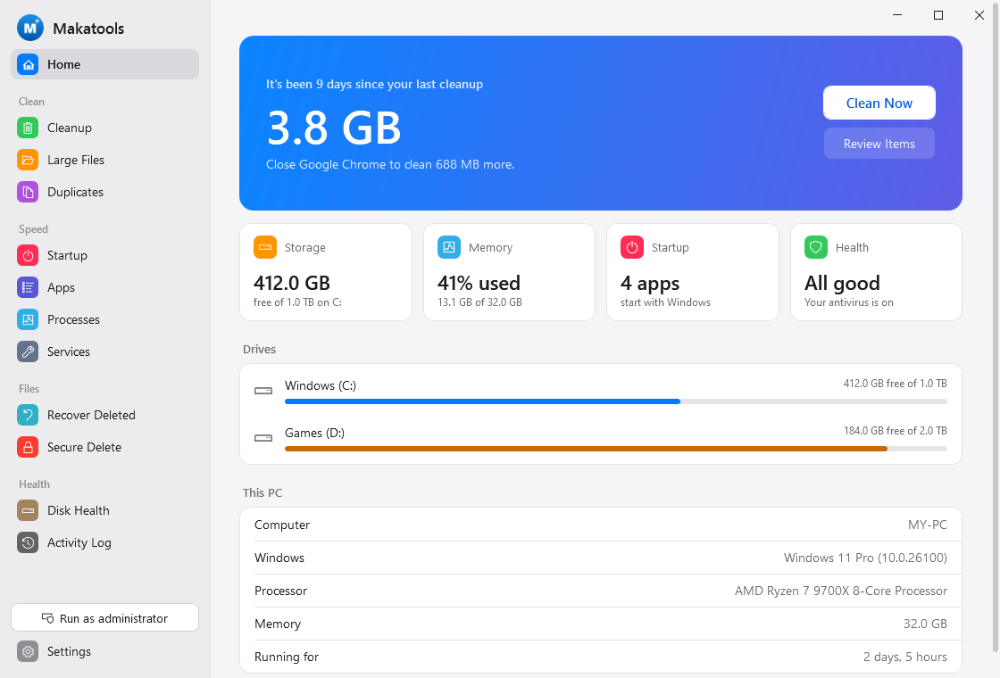
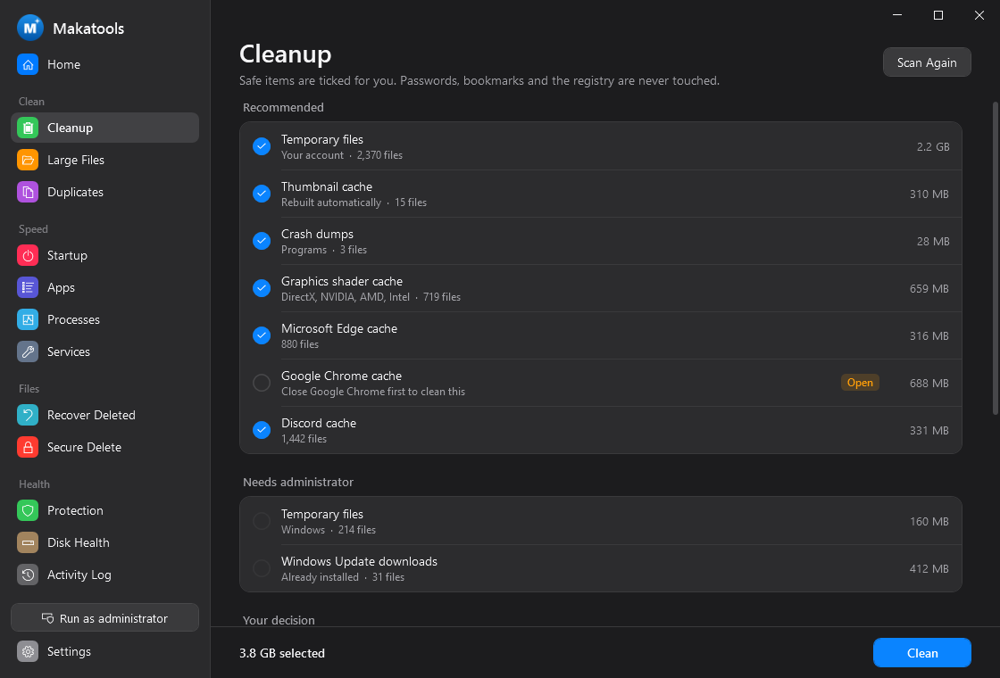

# Makatools

Free tools to clean up, speed up and look after your PC. For Windows 10 and 11 (64-bit). No ads, no paid tiers, no telemetry.



## Install

Download **`Makatools-Setup.exe`** from the [latest release](https://github.com/onlyilir/makatools/releases/latest) and run it. It installs for your Windows account only, so it needs no administrator rights, and it adds Makatools to your Desktop and Start menu.

Prefer not to install? Download the portable zip, extract it, and run `Start-Makatools.bat`.

**Updates:** when Makatools opens, it checks here for a new version and offers to install it in one click. A download only runs if its SHA-256 checksum matches the one GitHub published. Your settings and activity log are kept.

**Uninstall:** Settings > Apps > Makatools > Uninstall.

### Warnings you may see

Makatools isn't code-signed yet, so the first time you download and run it:

- **Microsoft Edge** may say the file "isn't commonly downloaded". Point at the download, choose **...** then **Keep**. On the next screen, open the arrow beside **Delete** and choose **Keep anyway**.
- **Windows SmartScreen** may say "Windows protected your PC". Choose **More info**, then **Run anyway**.
- **Your antivirus** may warn about a new file that few people have downloaded. That's about how new the file is, not anything it was found doing. All of the source code is here to read.

## What's inside

| | |
|---|---|
| **Home** | One-click cleanup, plus storage, memory, startup and health at a glance |
| **Cleanup** | Finds temporary files and caches, and ticks the safe ones for you |
| **Large Files** | The 200 biggest files in any folder |
| **Duplicates** | Identical copies of files, moved to the Recycle Bin if you choose |
| **Startup** | Switches for what starts with Windows, the same ones Task Manager uses |
| **Apps** | Everything installed, with its own uninstaller a click away |
| **Processes** | What's running, biggest first |
| **Services** | Start and stop Windows services |
| **Recover Deleted** | Puts Recycle Bin files back where they came from |
| **Secure Delete** | Overwrites a file with random data, then deletes it |
| **Disk Health** | Drive health, temperature, wear, error checks and optimizing |
| **Activity Log** | Every change Makatools has made |

Light and dark mode follow Windows, or choose in Settings.



### What Cleanup removes

Ticked for you, because Windows and your apps rebuild them on their own:

- Temporary files
- Browser caches: Edge, Chrome, Brave, Vivaldi, Opera, Opera GX, Firefox (every profile)
- Thumbnail cache and the Internet cache used by Windows apps
- Error reports and crash dumps
- Graphics shader caches (DirectX, NVIDIA, AMD, Intel)
- Windows Update downloads that are already installed, the Delivery Optimization cache, and old setup logs
- App caches: Discord, Microsoft Teams, Spotify, Steam, Zoom logs

Listed but **never ticked for you**:

- The Recycle Bin, because emptying it can't be undone
- `Windows.old`, the previous Windows left after a big update. Removing it takes away the option to go back.
- **Privacy items:** browsing history and cookies for each browser (clearing cookies signs you out of websites), and the recently opened files list. Firefox history isn't offered, because Firefox keeps it in the same file as your bookmarks.

Makatools **never** touches saved passwords, bookmarks, autofill, documents or the registry. Files in use are skipped. If a browser is open, its cache waits until you close it.

## Safe by design

- Anything that deletes or changes something asks first, and is written to the Activity Log.
- Makatools refuses to switch off, stop or end antivirus software, including Norton 360, Microsoft Defender, Avast, AVG, McAfee, Kaspersky, Bitdefender, ESET and Malwarebytes.
- Nothing runs in the background. Makatools only does things while you have it open.

## Limits

- **Recover Deleted only covers the Recycle Bin.** Files removed with Shift+Delete or shredded can't be recovered here. True undelete needs low-level disk tools.
- **Secure Delete isn't a guarantee on SSDs.** The drive itself can keep old copies of data.
- **No registry cleaner, on purpose.** Removing "broken" registry entries rarely speeds Windows up and can break software.
- Some apps use unusual uninstall commands that may not start from Apps. Use Settings > Apps for those.
- Disk temperature and wear need administrator rights.

## For developers

```
Makatools.ps1             entry point (one window only; relaunches in 64-bit PowerShell if needed)
src\Core.ps1              all logic, no UI
src\Ui.ps1                connects the window to the logic; slow work runs in background runspaces
src\MainWindow.xaml       the window (WPF)
src\Theme.xaml            design system: type, buttons, switches, lists
src\Colors.*.xaml         light and dark colours
setup\Setup.cs            the installer (C# 5, WPF), compiled with the csc.exe that ships with Windows
build\Build.ps1           makes dist\Makatools-Setup.exe and the portable zip
build\Publish-Release.ps1 tests, builds and publishes a GitHub release (-DryRun to rehearse)
build\Make-Logo.ps1       makes the logo and icon
tests\Run-Tests.ps1       core and UI tests; run it again as administrator to include the admin tests
tests\Test-Setup.ps1      install, update and uninstall tests against temp folders
tests\Snapshot-Ui.ps1     renders every screen to PNG, off-screen, with sample data
```

Script files must stay pure ASCII, because PowerShell 5.1 misreads anything else. A test enforces this.

MIT License.
